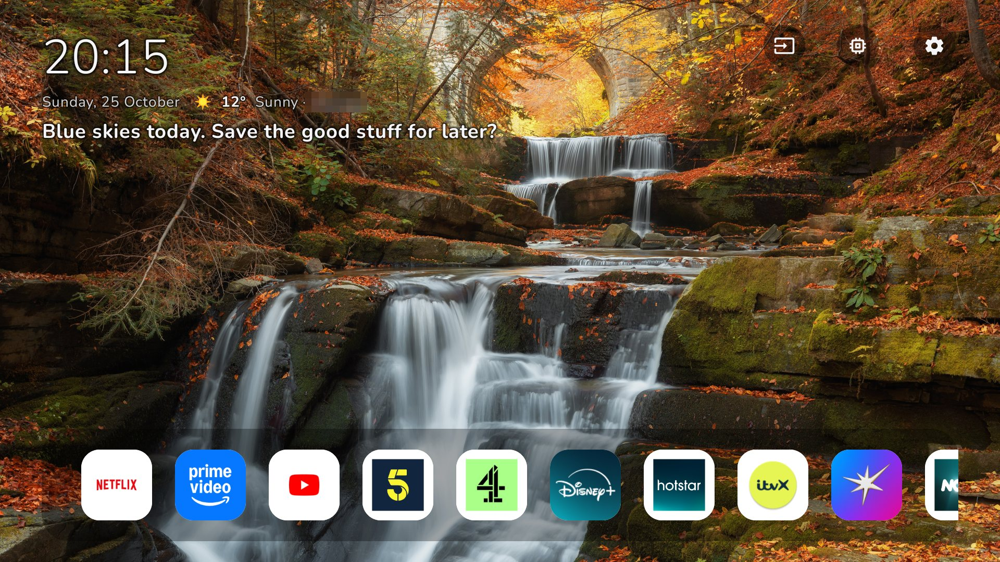
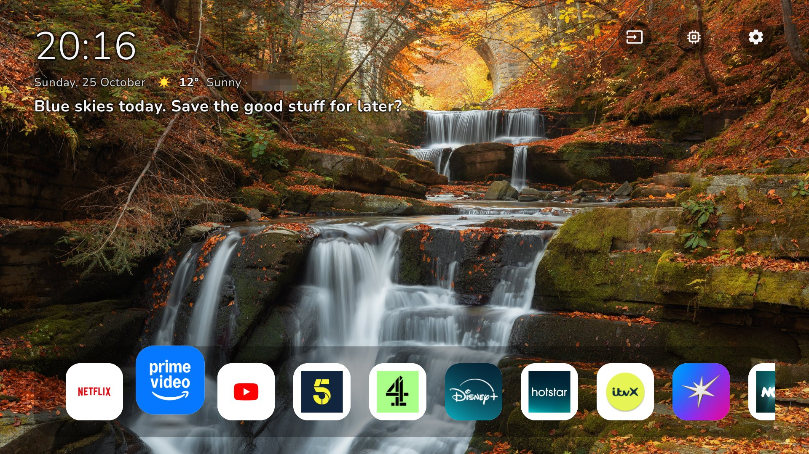
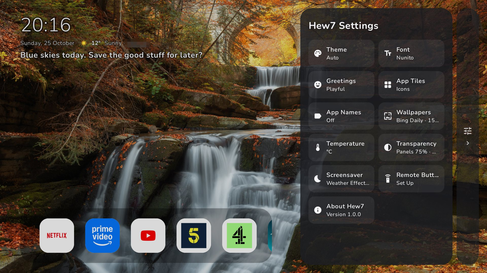
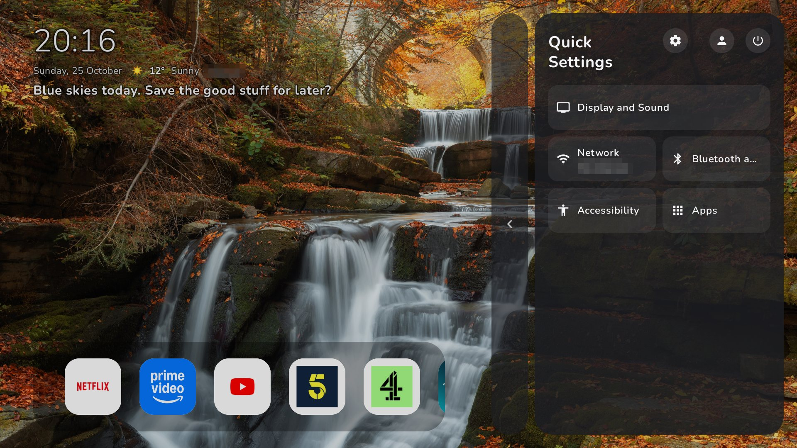
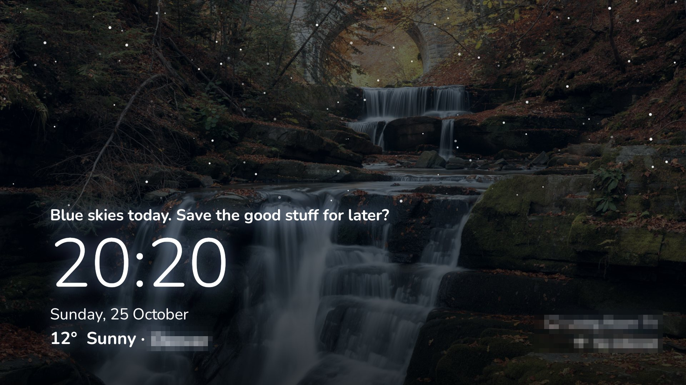

<p align="center">
  
</p>

# Hew7

**A launcher for Android TV and Google TV.** One clean app dock, living wallpapers, the time,
weather and a greeting that changes through the day, and a weather screensaver. No accounts, no
ads, no tracking.



| | |
|---|---|
|  |  |
|  |  |

## Features

- **App dock** in the order you choose, with a 3D highlight, wrap-around, a hidden Play Store tile
  (Left on the first app), reordering and an app menu (long-press or the remote's Menu button).
- **Wallpapers** that change every few minutes: Bing daily images or random photos, decoded at
  your screen's size.
- **Readable on any picture:** text and buttons pick light or dark ink from the wallpaper behind
  them; light and dark theme switch at sunrise and sunset.
- **Weather screensaver:** rain, snow, sun and stars over your wallpaper. Energy saving: **Calm
  After** stops the animation (CPU drops from ~100% to almost nothing) and **Sleep After** puts the
  TV in standby.
- **Machine Room:** CPU, memory, storage and network, plus **Running Apps** to close apps.
- **Hew7 Settings:** theme, font, greetings, app tiles and names, wallpapers, temperature,
  transparency, screensaver, remote buttons.
- **Quick Settings:** Display and Sound, Network, Bluetooth and Remotes, Accessibility, Apps,
  All Settings, Accounts, and **Power** (Restart, Shut Down).
- **Remote Buttons:** Hew7 reads each button's name from your TV, so any remote works. Set what
  Settings, Apps, Menu, colour and other buttons do; app buttons (Netflix, YouTube, Prime Video…)
  open their apps from anywhere.
- Light: about 2.6 MB, ~100 MB of memory, and nothing drawn while idle.

## Install

You need a computer with [ADB](https://developer.android.com/tools/releases/platform-tools) and
**USB debugging** turned on in the TV's Developer options.

1. Download `Hew7.Launcher-<version>.apk` from [Releases](../../releases) into the `scripts` folder.
2. Run this, replacing YOUR-TV-IP with your TV's IP address (Settings › Network and Internet):
   ```powershell
   powershell -ExecutionPolicy Bypass -File scripts\Hew7-Setup.ps1 -TvIp YOUR-TV-IP
   ```
   This installs Hew7, gives it the permissions only ADB can give, makes it the home screen and
   screensaver, and saves your TV's original settings first.
3. On the TV, switch on **Hew7 Helper** when the Accessibility page opens (optional, see below).

To go back to the TV's own home screen, and optionally remove Hew7:

```powershell
powershell -ExecutionPolicy Bypass -File scripts\Hew7-Undo.ps1 -TvIp YOUR-TV-IP -Uninstall
```

Add `-DryRun` to either script to see what it would do. More in [`scripts/How to use.txt`](scripts/How%20to%20use.txt).

## Hew7 Helper (optional)

An Accessibility service you switch on yourself, after Hew7 explains what it does. It lets Hew7
do things only the TV's own system can: close apps from Running Apps (by pressing Force Stop for
you), open Display and Sound and Accounts directly, Restart and Shut Down, and make the remote's
Settings, Input, Menu and app buttons work with Hew7. It reads only the TV's settings screens and
power menu while doing these jobs, and collects nothing.

Android stops the Helper whenever Hew7 is updated; switch it off and on again afterwards.

## Build from source

Requirements: Android Studio (or JDK 17+) and the Android SDK.

```powershell
.\gradlew.bat assembleRelease   # APK
.\gradlew.bat bundleRelease     # App Bundle for Google Play
```

Without a `keystore.properties` file the release build is signed with the debug key (fine for
testing). To sign with your own key, create `keystore.properties` next to `build.gradle.kts`:

```properties
storeFile=../release-keys/your-upload-key.jks
storePassword=...
keyAlias=...
keyPassword=...
```

Tested on a TCL Google TV (Android 11). Some features use TCL's own settings screens and fall
back to standard Android ones on other TVs.

## Privacy

Hew7 keeps your settings on the TV. For the weather it looks up your approximate location from
your internet address and asks Open-Meteo for the forecast; wallpapers come from Bing or Picsum.
Nothing else leaves the TV. Full policy: [docs/PRIVACY_POLICY.md](docs/PRIVACY_POLICY.md).

## License and trademarks

The source code is licensed under the [Apache License 2.0](LICENSE). © 2026 Hew7 Studio.

**"Hew7", "Hew7 Launcher", "Hew7 Studio" and the Hew7 logo are trademarks of Hew7 Studio and are
not covered by the license.** If you build your own app from this code, give it a different name,
logo and app ID; see [TRADEMARKS.md](TRADEMARKS.md).

Third-party libraries, fonts and data: [THIRD_PARTY_NOTICES.txt](THIRD_PARTY_NOTICES.txt).
Android, Android TV and Google TV are trademarks of Google LLC; Hew7 isn't affiliated with or
endorsed by Google, TCL, Netflix or other app makers.

